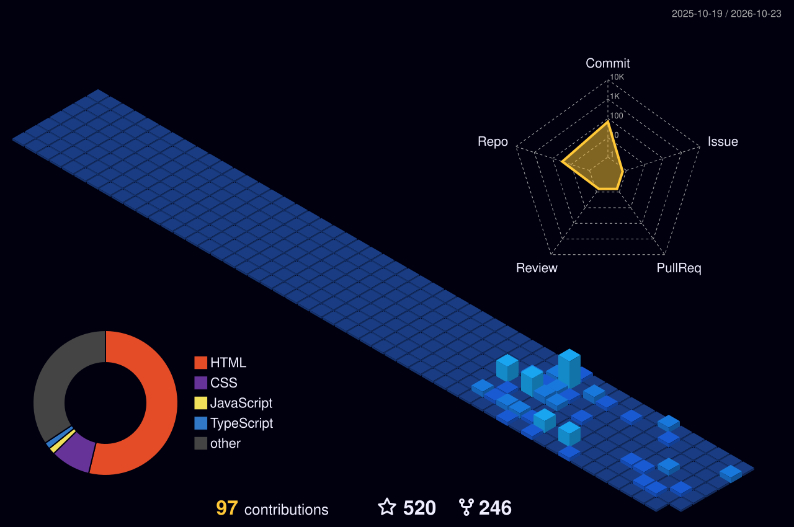

<!-- 🎬 HERO  video intro -->

  

 

<!-- 🍥 MY NINJA WAY -->

  

<!-- 🔦 JUTSU ARSENAL -->

  

<!-- 🪪 NINJA REGISTRATION + MISSION DASHBOARD -->

  

## 🍥 S-Rank Missions

<table>
<tr><th>Mission</th><th>What it is</th><th>Jutsu used</th><th align="center">⭐</th></tr>
<tr><td><a href="https://github.com/Meghamittal0920/itachi"><b>Itachi</b></a></td><td>Cinematic Uchiha experience  crows, sharingan, scroll-driven story</td><td><code>JavaScript</code> <code>CSS</code></td><td align="center"><b>175</b></td></tr>
<tr><td><a href="https://github.com/Meghamittal0920/Naruto-SageMode"><b>Naruto  Sage Mode</b></a></td><td>Awwwards-style scroll experience with a thunder-crack transformation</td><td><code>HTML</code> <code>GSAP</code></td><td align="center"><b>72</b></td></tr>
<tr><td><a href="https://github.com/Meghamittal0920/Zoro-King-of-hell"><b>Zoro  King of Hell</b></a></td><td>Cinematic character landing page</td><td><code>HTML</code> <code>CSS</code> <code>JS</code></td><td align="center"><b>23</b></td></tr>
<tr><td><a href="https://github.com/Meghamittal0920/Minato"><b>Minato</b></a></td><td>Flying Raijin speed  motion-heavy tribute build</td><td><code>JavaScript</code></td><td align="center"><b>22</b></td></tr>
<tr><td><a href="https://github.com/Meghamittal0920/Gojo"><b>Gojo</b></a></td><td>Infinity / Six Eyes themed interactive page</td><td><code>HTML</code> <code>CSS</code></td><td align="center"><b>21</b></td></tr>
<tr><td><a href="https://github.com/Meghamittal0920/One-Piece-3D-Website"><b>One Piece 3D</b></a></td><td>3D web experience on the Grand Line</td><td><code>TypeScript</code> <code>Three.js</code></td><td align="center">⚓</td></tr>
</table>

<a href="https://github.com/Meghamittal0920?tab=repositories"><b>→ See all 32 repositories</b></a>

  

### 🌃 My contribution village

*Every commit raises another building  rebuilt automatically every day.*

  

<!-- 💌 JOIN THE SQUAD -->

  

 

**Dattebayo  keep coding, keep growing.** 🍥

